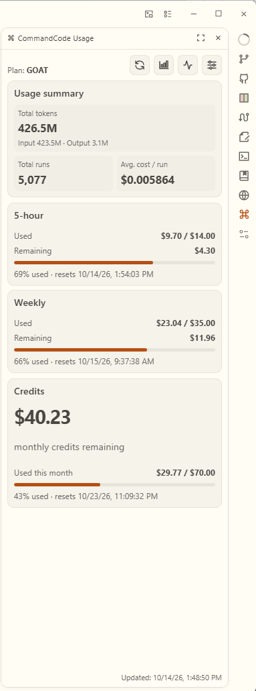
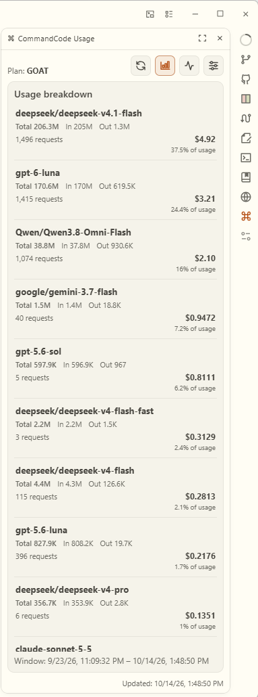
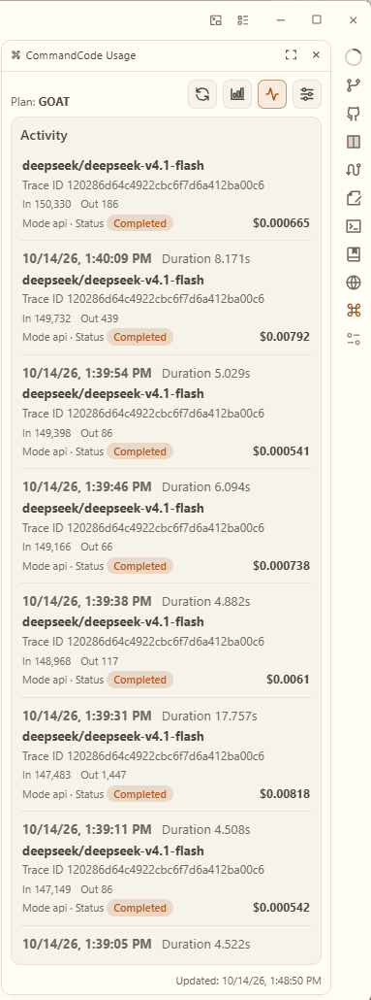
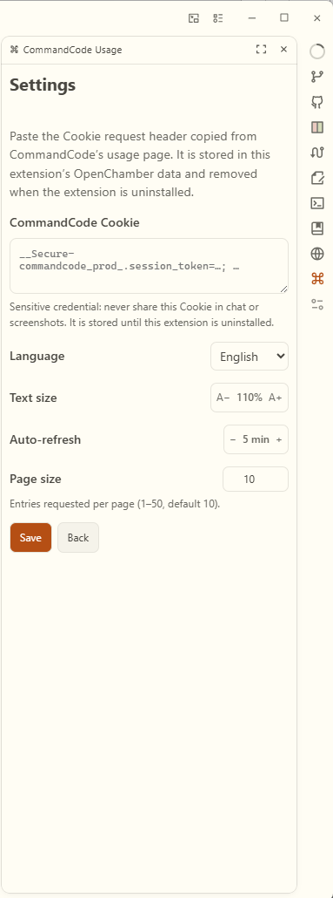

# CommandCode Usage

A lightweight OpenChamber extension for checking CommandCode usage limits, monthly credits, and subscription details, with automatic refresh and smooth value animations.

English | [简体中文](README.zh-CN.md)

<p align="center">
  
  &nbsp;&nbsp;
  
  <br><br>
  
  &nbsp;&nbsp;
  
</p>

## Features

- Displays rolling **5-hour** and **weekly** usage windows, followed by monthly credit balance.
- Shows total tokens, input/output token breakdown, total runs, and average cost per run.
- Lists usage for each model sorted by its share of credits consumed, highest first, including total/input/output tokens, request counts, failures, and credits consumed.
- Adds an **Activity** action on the home panel that shows model calls in the same table layout as Usage breakdown. It loads 10 entries per page by default and fetches more on scroll: time, all input tokens, output tokens, duration, model, mode, status, cost, and trace ID.
- Shows the provider logo before each model name in **Usage breakdown** and **Activity**. Logos come from models.dev (`/logos/labs/{lab}.svg`), matched via a bundled `model → lab` map; models with no match fall back to models.dev's default icon.
- Adds an **Update model icons** action in Settings that fetches the latest `model → lab` mapping from models.dev, so models added after this version still get logos; the result is remembered in extension storage.
- Shows the subscription plan when available; the `Active` status is hidden.
- Refreshes on demand or automatically while the panel is open. Configure the interval in Settings from 1 to 60 minutes in one-minute steps; the default is five minutes.
- Animates changing values with a vertical slide and fade inside a clipped, fixed-height line box, alongside smoothly updated progress bars. The animation respects the system's reduced-motion preference.
- Includes in-panel controls for text size, auto-refresh interval, and Activity page size; every preference is saved. Text size adjusts in 5% steps; the Activity page size is a manual entry from 1 to 50 and defaults to 10.
- Opens Settings on first launch so you can add your Cookie immediately.
- Includes English and Simplified Chinese UI.
- Stores the CommandCode Cookie, language, text size, auto-refresh interval, Activity page size, and the updated model map in OpenChamber extension storage so they remain available after reopening the panel.

## Requirements

- [OpenChamber](https://github.com/openchamber/openchamber) **1.24.0 or later**.
- For building from source: [Bun](https://bun.sh/).

## Install

### Install from a ZIP

1. Download `commandcode-usage.zip` from the project's GitHub Releases (once a release is published).
2. In OpenChamber, open **Settings → Extensions** and install the ZIP. The ZIP must contain `package.json` at its root; do not zip the parent project folder.
3. Review the extension source and approve its local service when prompted.
4. Open the **CommandCode Usage** panel. On first launch, Settings opens automatically; paste your own CommandCode `Cookie` request header, choose a language, and select **Save**.

### Install from a local folder

1. Clone or download this repository.
2. In the extension folder, run `bun install` and `bun run build` to generate the panel and service JavaScript.
3. In OpenChamber, open **Settings → Extensions** and add the extension folder.
4. Review and approve the local service when prompted.
5. Open the panel; Settings opens automatically if no Cookie has been saved. Paste your Cookie and select **Save**.

The distributed ZIP contains the built JavaScript files and does not require Bun on the target machine.

If OpenChamber cannot parse or install the ZIP, verify that it was built from the project folder and includes `package.json`, `panel/index.html`, `panel/main.js`, the declared icon, and `service/main.js`. The package manifest must have a valid version. Rebuild and create a fresh ZIP rather than renaming or manually nesting an archive.

## Build and package

From the extension directory:

```sh
bun install
bun run build
```

Model logos use a bundled `panel/model-labs.json` (CommandCode model id → models.dev lab). `bun run build` regenerates it first (via `prebuild`); the script keeps the existing file if models.dev is unreachable. To regenerate it on its own:

```sh
bun run gen:model-labs
```

On Windows, run `pack-plugin.ps1` in PowerShell to create `commandcode-usage.zip` in this directory. The script validates the manifest and built files, then packages only the files required to install and run the extension, including the MIT `LICENSE`; documentation, TypeScript sources, and `node_modules` are not included. Increment the `version` in `package.json` before publishing an updated release.

## Cookie and privacy

The Cookie is a **sensitive bearer credential** that grants access to your signed-in CommandCode account. Use only your own Cookie. Never include it in screenshots, chat messages, bug reports, source code, or public issues.

- The extension saves the Cookie in OpenChamber's extension-scoped storage. Uninstalling the extension removes its storage namespace.
- The local service filters the supplied header and forwards only recognized CommandCode session cookies (`session_token` and `session_data`). It does not intentionally log or persist the credential; the Cookie itself remains saved in OpenChamber extension storage until changed or the extension is uninstalled.
- Usage requests are sent to `https://api.commandcode.ai` only. The service binds to `127.0.0.1` and accepts requests authenticated with the host-provided service token.
- To draw model logos, the local service fetches SVG files from `https://models.dev/logos/...` on the panel's behalf (the sandboxed panel cannot reach the network), and pressing **Update model icons** also fetches `https://models.dev/api.json` to refresh the model → provider mapping. These requests carry only model/provider names; no Cookie or usage data is sent.
- The extension does not send the Cookie or usage data to this project's maintainers or to a third-party analytics service.
- The extension's local service runs with the access granted by OpenChamber. Review the source before approving it, especially when installing a build from someone else.

## Data source and limitations

The extension currently reads these CommandCode endpoints:

- `GET https://api.commandcode.ai/internal/billing/credits`
- `GET https://api.commandcode.ai/internal/billing/subscriptions`
- `GET https://api.commandcode.ai/internal/usage/summary`
- `GET https://api.commandcode.ai/internal/usage/by-model`
- `GET https://api.commandcode.ai/internal/usage?limit=10` (with `cursor` for subsequent pages; `limit` defaults to 10 and is configurable from 1 to 50 in Settings)
- `GET https://models.dev/logos/labs/{lab}.svg` (provider logos for the model names)
- `GET https://models.dev/api.json` (only when you press **Update model icons**; refreshes the `model → lab` mapping)

These are **undocumented internal endpoints**, not a stable public API. CommandCode may change or remove them at any time, which can temporarily or permanently break usage reporting. The panel only displays data returned by the endpoints.

Monthly remaining credits, token totals, input/output token counts, total runs, and average cost are shown when returned by the endpoints. Per-model token totals, input/output tokens, request counts, failed requests, and credits consumed are listed with the models consuming the largest share of credits first; models without credit data fall back to request count, then name. A monthly used percentage is shown only when the subscription plan and rolling usage caps match the extension's built-in plan catalog; otherwise, the extension avoids estimating a total allowance. Monthly reset time is shown when the credits endpoint provides it, with the subscription period end used as a fallback.

The **Activity** page fetches model-call records from the internal usage endpoint in pages of 10 by default (configurable from 1 to 50 in Settings), loading the next page when scrolled to the bottom. Fields not returned by the endpoint appear as a dash. Trace IDs are displayed locally and are not sent to any other service.

This project is an independent, community-maintained extension and is not affiliated with, endorsed by, or supported by CommandCode. Use is subject to CommandCode's terms and policies.

## Troubleshooting

- **OpenChamber cannot parse or install the ZIP:** create a fresh archive with the supplied packaging script. Check that `package.json` is at the archive root, contains a valid `version`, and that all built entry files are present.
- **Usage cannot be loaded:** confirm the network can reach `api.commandcode.ai`, then check that the Cookie is current. Re-copy the Cookie request header from CommandCode if it was rejected or expired.
- **The panel or service does not start after editing source:** run `bun install` and `bun run build` again, then reload or reinstall the extension so OpenChamber uses the rebuilt JavaScript.
- **Usage data is missing or looks incomplete:** the internal endpoints may have changed, or CommandCode may not return that field for the current account or plan.
